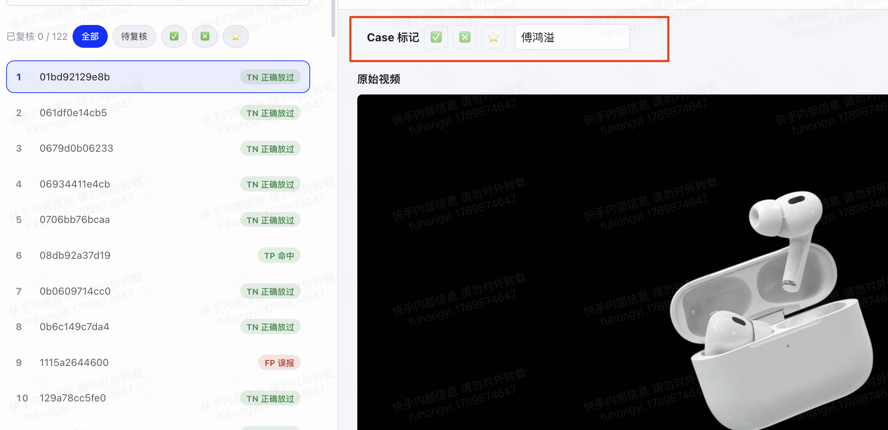
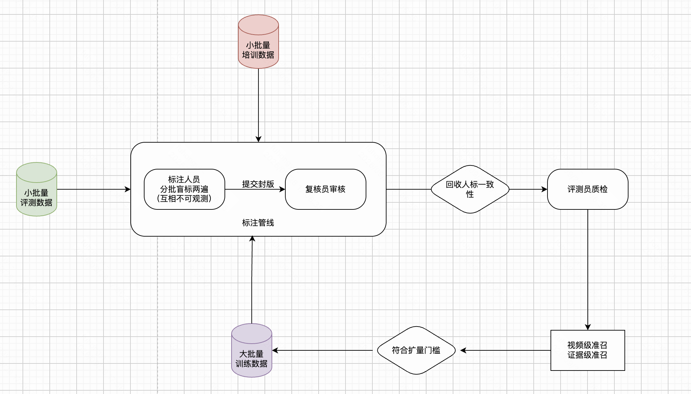
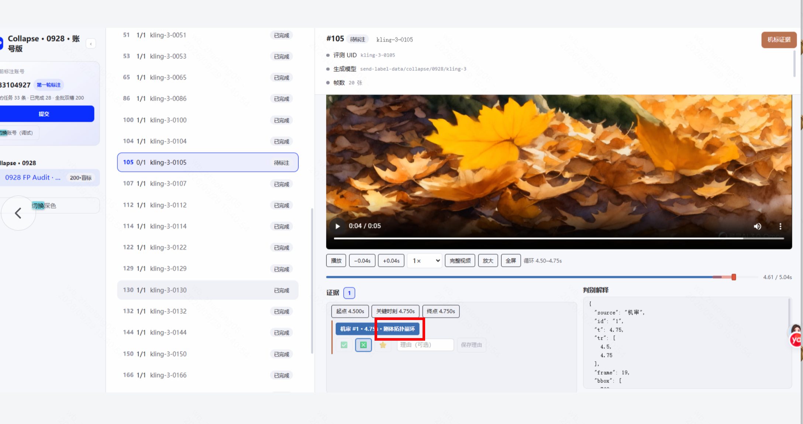
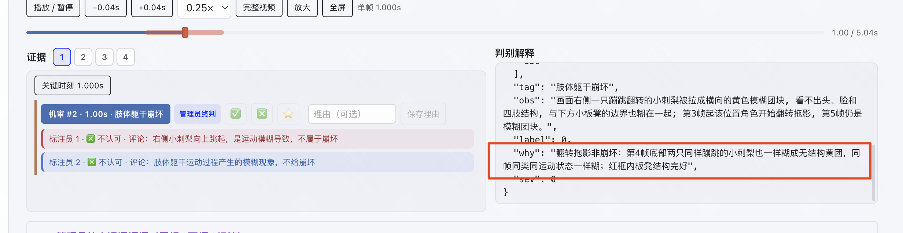
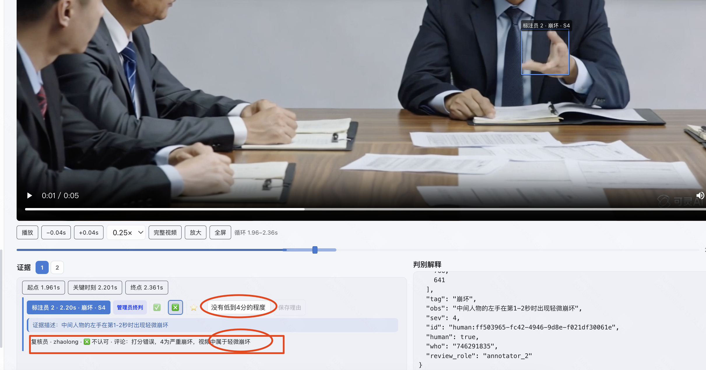
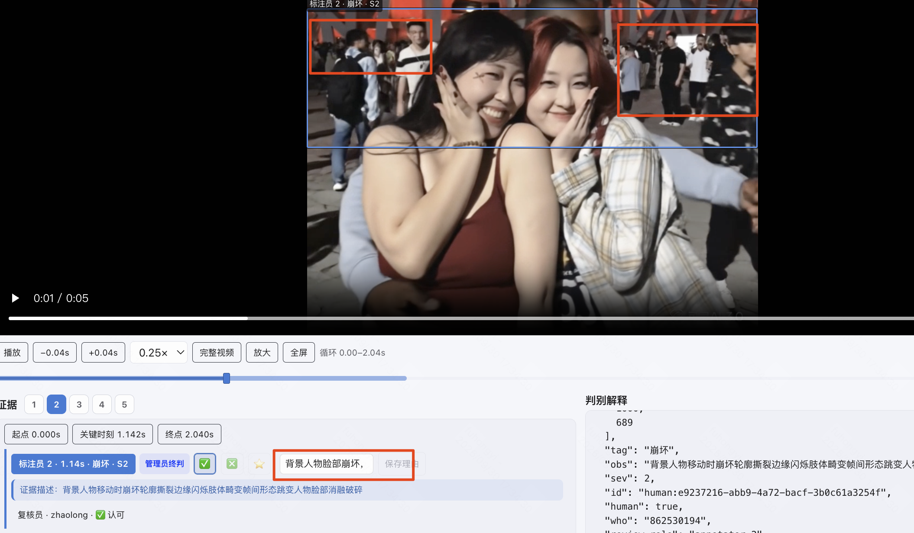

# 标注平台使用示范
# 视频级标注
为整个视频打标，表明该视频存在某个质检问题，比如文字不可读，轻微文字不可读，非文字不可读。

✅：存在该 Tag 问题
❎：不存在该 Tag 问题
⭐️：问题轻微（属于模糊地带）。

# 证据帧级别标注
## 人类专家的金标证据
核心目的：人标证据的作用是优化模型的证据召回率，尽可能标出人眼能感知到的所有证据。
对于所有人审认为有问题的视频需要提供人类专家的细粒度标注信息，所有的证据标注都要精确到时空位置，以及给出严重程度（1-4）。
严重程度的细化定义需根据不同 Tag 找算法侧对齐。

### 标注 Demo：
每一个证据帧由起始帧，末尾帧和关键帧，三帧定位得到。如下视频：
[视频](media/video-01.mp4)
什么时候需要标证据帧的起末区间：
对于动态质量下的问题，比如「崩坏」，「异常静止」等标签其需要结合某个视频片段进行分析才能得出结论，所以不是只对单帧进行标注，需要框定能决策崩坏的视频区间。
对于「文字不可读」这类标签，通常是只需要少量帧，甚至单帧就能实现判别。

## 机标证据的复核
对于模型给的证据，需要人工审核是否正确。
打✅，表示人类专家接收机器给的该证据，认同其推理和分析。不需要给原因。
打❎，表示人类专家拒绝机器该证据，需要给原因，简述为什么错误，常见的比如：
模型描述的该主体 / 物体 / 目标，不存在该问题，或者人眼几乎不可分辨。
打⭐️，表示认为该证据有一定的道理，但模糊较轻微（机审吹毛求疵），需要给原因，简述为什么如此：
模型描述的该主体 / 物体 / 目标，确实存在该问题，但是存在的时间极端 / 面积极小，人眼不太注意到，判为轻微。

[视频](media/video-02.mp4)

# 数据批次
试标注（考核数据）
<table><tr><td>时间
</td><td>链接
</td></tr><tr><td>0920
</td><td>[合理性](https://video-arena.k7z9x.com/keyelabel/reasonable-0920-account.html#ef~%E5%90%88%E7%90%86%E6%80%A7%20%C2%B7%200920~rsn250-hypo1-lcyv7-250-20260920~kimi-k3~20260920-104648)（有机标）
</td></tr><tr><td>0928
</td><td>[速度异常](https://video-arena.k7z9x.com/keyelabel/speed-0928-account.html#ef~Speed%20%C2%B7%200922~batch1_130~motion-qc~20260922-000000)（有机标）
[崩坏](https://video-arena.k7z9x.com/keyelabel/collapse-0928-account.html#ef~Collapse%20%C2%B7%200928~0928-l1-expanded-v4-fp-audit~kimi-k3~20260928)（有机标）
</td></tr><tr><td>0929
</td><td>[基础内容指令遵循 - 动作文本响应](https://video-arena.k7z9x.com/keyelabel/action-0929-account.html#ef~Action%20%C2%B7%200929~action-0929-200~none~20260929)（无机标）
</td></tr></table>

培训数据
<table><tr><td>时间
</td><td>链接
</td></tr><tr><td>历史考核数据转培训用
</td><td>[崩坏](https://video-arena.k7z9x.com/keyelabel/collapse-0928-teach.html#ef~Collapse%20%C2%B7%200928~0928-l1-expanded-v4-fp-audit~kimi-k3~20260928)
[速度异常](https://video-arena.k7z9x.com/keyelabel/speed-0928-teach.html#ef~Speed%20%C2%B7%200922~batch1_130~motion-qc~20260922-000000)
[合理性](https://video-arena.k7z9x.com/keyelabel/reasonable-0920-teach.html#ef~%E5%90%88%E7%90%86%E6%80%A7%20%C2%B7%200920~rsn250-hypo1-lcyv7-250-20260920~kimi-k3~20260920-104648)
</td></tr><tr><td>1008
</td><td>[动作文本响应](https://video-arena.k7z9x.com/keyelabel/action-0929-teach.html#ef~Action%20%C2%B7%200929~action-0929-200~none~20260929)
</td></tr><tr><td>1010
</td><td>[多镜头指令遵循](https://video-arena.k7z9x.com/keyelabel/multi-camera-1008-teach.html#ef~%E5%A4%9A%E9%95%9C%E5%A4%B4%E6%8C%87%E4%BB%A4%E9%81%B5%E5%BE%AA%20%C2%B7%201008~1008-200-2stage~newapi-kimi-k3-v1~20261009-054425-1009-full200-klink)
[主体文本响应](https://video-arena.k7z9x.com/keyelabel/main-body-0930-teach.html#ef~%E4%B8%BB%E4%BD%93%E6%96%87%E6%9C%AC%E5%93%8D%E5%BA%94%20%C2%B7%200930~0930-200-2stage~newapi-kimi-k3-v2-code~20260930-222511-0930-2220-dyn-v2-code)
[响应与指代混淆](https://video-arena.k7z9x.com/keyelabel/ref-error-0930-teach.html#ef~%E5%93%8D%E5%BA%94%E6%B7%B7%E6%B7%86%E4%B8%8E%E6%8C%87%E4%BB%A3%E9%94%99%E8%AF%AF%20%C2%B7%200930~0930-200-2stage~newapi-kimi-k3-v2-code~20260930-222735-0930-2220-dyn-v2-code)

</td></tr><tr><td>1013
</td><td>[一致性](https://video-arena.k7z9x.com/keyelabel/consistency-1013-teach.html#ef~%E4%B8%80%E8%87%B4%E6%80%A7%20%C2%B7%201013~consistency-1013-94~none~20261013)
注：一个问题由于涉及多个镜头多个时间片段，因此标注时，同一问题的备注要一模一样，并且给一个前序的罗马数字编号
如：1、同一人在多镜头间肤色不一致
</td></tr><tr><td>1020
</td><td>[运镜文本响应](https://video-arena.k7z9x.com/keyelabel/move-camera-1015-teach.html#ef~Move-Camera%20%C2%B7%201015~group01~human-gold~20261015)
</td></tr></table>
标注数据
<table><tr><td>时间
</td><td>链接
</td></tr><tr><td>1015
</td><td>[崩坏（200 x 15）](https://video-arena.k7z9x.com/keyelabel/collapse-1015-account.html#ef~Collapse%20%C2%B7%201015~group01~kling-3~20261015)
[崩坏（216 x 4）](https://video-arena.k7z9x.com/keyelabel/collapse-1021-account.html#ef~Collapse%20%C2%B7%201021~group01~i2va-mix~20261021)
</td></tr><tr><td>
</td><td>多镜头指令遵循（200 x 15）
动作文本响应（200 x 15）
运镜（200 x 15）
主体文本响应（200 x 15）

</td></tr><tr><td>1021
</td><td>[一致性 · 1022 双人盲标账号版](https://video-arena.k7z9x.com/keyelabel/consistance-1022-account.html#ef) 200 x 3

[一致性 · 1022 双人盲标账号版 · 新增Omni和脏数据标签](https://video-arena.k7z9x.com/keyelabel/consistance-1022-tags-account.html) 200 x 3

[多镜头指令遵循（200x15）](https://video-arena.k7z9x.com/keyelabel/multi_camera-1021-account.html#ef~%E5%A4%9A%E9%95%9C%E5%A4%B4%E6%8C%87%E4%BB%A4%E9%81%B5%E5%BE%AA%20%C2%B7%201021~group01~kling-online~20261021)
</td></tr><tr><td>1023
</td><td>[一致性 · 1023-2000 双人盲标账号版](https://video-arena.k7z9x.com/keyelabel/consistance-1023-2000-account.html#ef) 200 x 10

[一致性 · 1023-2000 双人盲标账号版 · 新增Omni和脏数据标签](https://video-arena.k7z9x.com/keyelabel/consistance-1023-2000-tags-account.html) 200 x 10

[一致性 · 1023 双人盲标账号版](https://video-arena.k7z9x.com/keyelabel/consistance-1023-account.html#ef) 200 x 1 Benchmark
</td></tr><tr><td>1029
</td><td>[多镜头指令遵循（8 x 200 -> 后续会补到 5k）](https://video-arena.k7z9x.com/keyelabel/multi_camera-1029-account.html#ef~%E5%A4%9A%E9%95%9C%E5%A4%B4%E6%8C%87%E4%BB%A4%E9%81%B5%E5%BE%AA%20%C2%B7%201029~group01~kling-online~20261029)
[运镜文本响应（10x200 -> 后续会补到5k）](https://video-arena.k7z9x.com/keyelabel/move-camera-1029-account.html#ef~%E8%BF%90%E9%95%9C%E6%96%87%E6%9C%AC%E5%93%8D%E5%BA%94%20%C2%B7%201029~group01~kling-online~20261029)
</td></tr><tr><td>1029
</td><td>[一致性 · 1028-20000 双人盲标账号版](https://video-arena.k7z9x.com/keyelabel/consistance-1028-20000-account.html#ef)
200 x 100

[一致性 · 1028-20000 双人盲标账号版 · 新增Omni和脏数据标签](https://video-arena.k7z9x.com/keyelabel/consistance-1028-20000-tags-account.html) 200 x 100
</td></tr></table>

# 标注流程

需要严格隔离培训数据，评测数据，训练数据：
培训数据：评测团队与标注团队反复打磨，对齐标注标准采用的数据。
评测数据：相当于标准团队的一份试卷，通过该次评测后，标注团队则可以进行更大批量的训练数据的标注。（因此评测数据需要与培训数据是完全不相交的）
训练数据：可灵线上回捞的无标签数据。

## 标注管线
根据标注人员数据平均分配数据，每个同学登录 1 个账号去盲标，对于其它标注员的结果是不可见的。标注结果提交后为封版，不可改动。

## 数据复核
分配了复核员的标注账号，当且仅当所有数据都标注完后，才可进行复核。不允许边标边复核。

# 评测流程
核心目的：评测标注人员产出的视频级标注 和 证据级标注的质量。
【标注】线索级别准召计算

# QA

## Q1：
Q1：这个刚体拓扑崩坏该怎么判断，出现崩坏是可以打✅吗，要备注一下吗

A1：
只需要看 Reason，不需要判模型给的细拆标签。优先看 why，why 为空时看 obs。

## Q2：关于严重度分级
A：
sev 区分：本次送标数据只有崩坏需要给 sev 等级（sev>=3 是明显崩坏 <3 轻微）。速度异常和合理性都没有给 sev 等级，不需要区分。
关于机标给的 sev 等级：标注和评测都不需要关注机标证据给的等级，只需要聚焦证据本身是否正确，正确时对应的给 sev 等级。
关于标注人员给的 sev 等级：评测人员需要关注，错了则在理由里修正。
更详细的解释：
机器的审核流程是先召回证据，再校验证据的严重度，所以会有一些证据在二阶段被判为 0。
标注和评测是不需要感知机标证据的严重度（sev）的，聚焦在证据本身是否正确。
人审接受的证据，严重度被机器判为 0 是正常的。

## Q3：关于✅❎⭐️
A：
✅❎⭐️ 不是判断前一轮的对错。
✅：存在该质检标签问题
❎：不存在该质检标签问题
⭐️：在判别的边界
常见错误如下：

这个复核和评测都认为是轻微崩坏，应该✅，原因里给个 sev = 1 即可

## Q4：Bbox 
A：
框和 reasoning 要对得上。

如下图，蓝框范围太大，红框正确：

## Q5：关于明显崩坏和轻微崩坏
A：
只要存在一个明显崩坏的证据则该视频必然是明显崩坏。
只要存在一个轻微崩坏的证据则该视频必然是轻微崩坏及以上。
假设一个视频存在多个轻微崩坏，是否要升级为明显崩坏，取决于评测团队的口径。

## Q6：关于指令遵循的标签拆分合并
A：只有动作文本响应和多镜头指令遵循是有下拆标签。
shot数量错误由shot数量遗漏 + shot数量新增 + shot数量错误共同合并得到。

## Q7：关于指令遵循的画框和视频段截取
A：
多镜头指令遵循中
shot数量错误：
视频段随意取
无框
无切镜：
视频段随意取
无框
切镜时间点错误：
视频段取切镜时间点，且左右两帧
无框
转场方式错误：
视频段取转场时间点，且左右两帧
无框
镜头间内容混淆：
视频段取镜头A的开始到镜头B的结束（假设镜头 A 和 镜头 B 内容混淆）
框取混淆的内容

